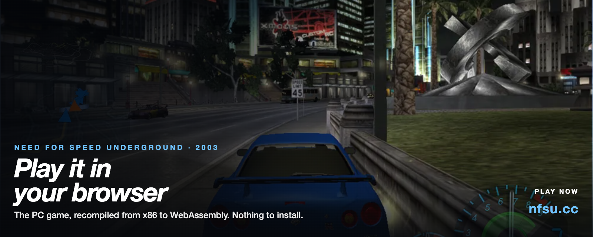
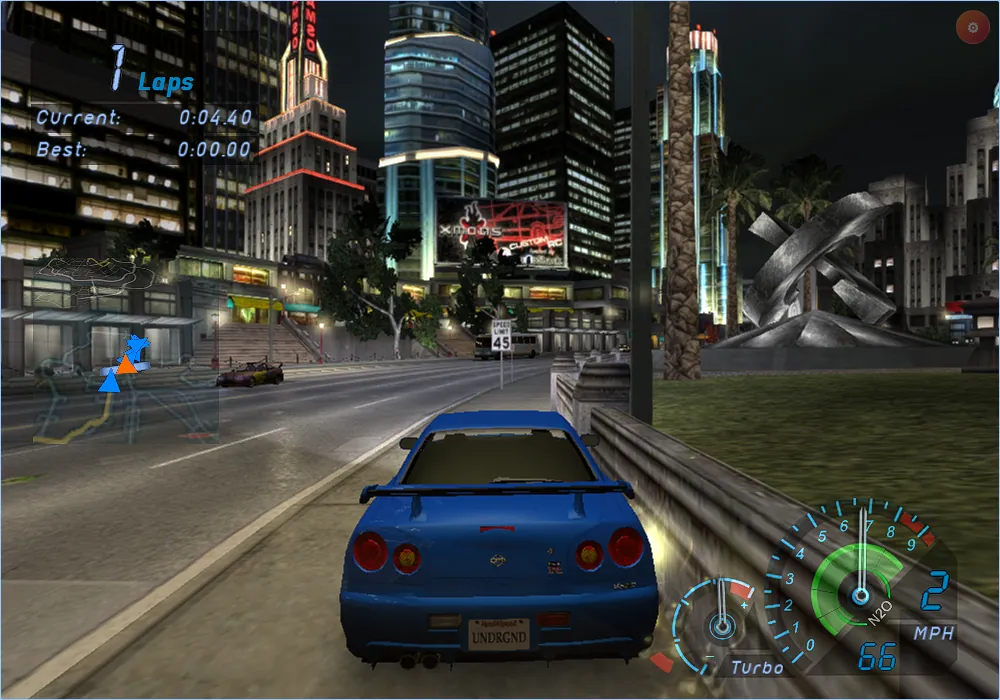
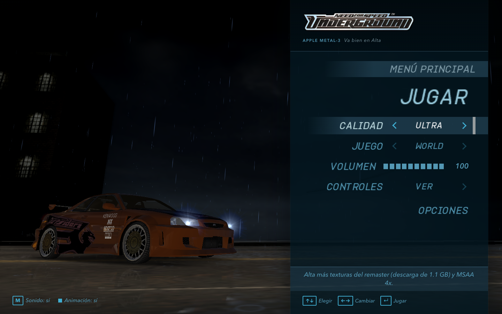
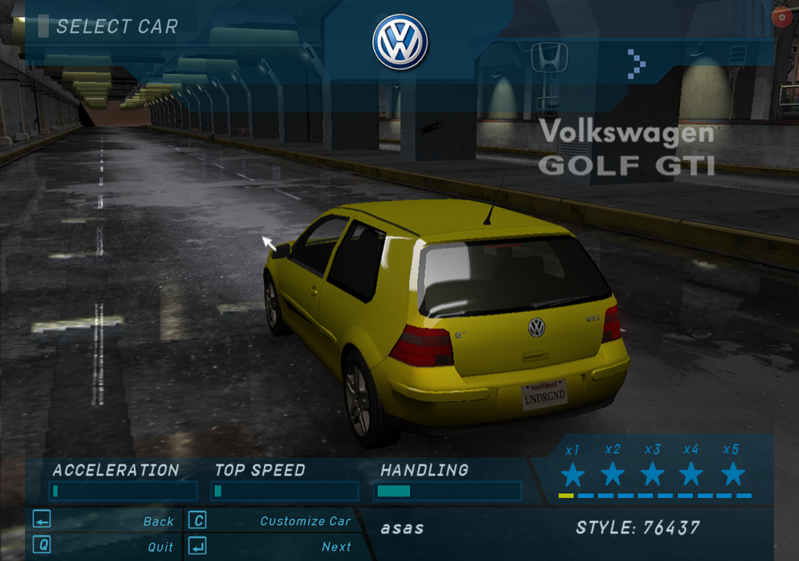
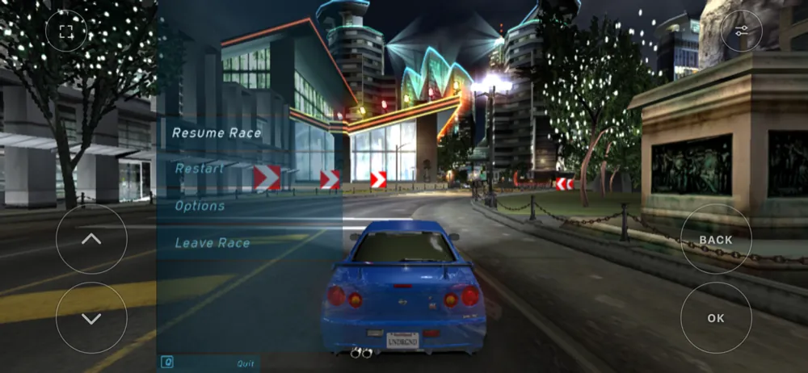
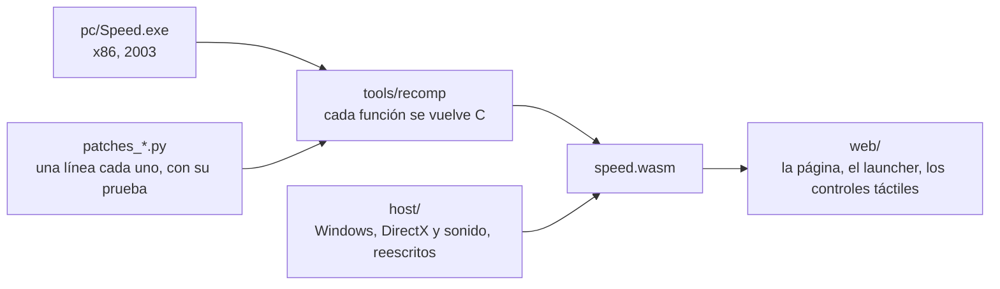

<div align="center">

<a href="https://nfsu.cc"></a>

# Juega Need for Speed Underground online, en tu navegador

**El juego de PC de 2003, gratis en una pestaña del navegador: sin descargar, sin instalar, sin emulador. Abre [nfsu.cc](https://nfsu.cc) y corre en PC o celular. Por dentro, cada función de `Speed.exe` se recompiló de x86 a WebAssembly.**

<a href="https://nfsu.cc"></a>


[English](README.md) · **Español**

[Jugar](https://nfsu.cc) · [Cómo se ve](#cómo-se-ve) · [Cómo funciona](#cómo-funciona) · [Guías](#guías-y-devlog) · [Mapa del repo](#mapa-del-repo)

</div>

> [!NOTE]
> Ningún emulador corre el juego. `Speed.exe` se lee una vez, de nuestro lado, y cada función se escribe de nuevo como código que un navegador entiende. Lo que se juega en la página es el juego de 2003: la misma física, los mismos rivales, los mismos menús, la misma música.

## Jugar

1. Abre **[nfsu.cc](https://nfsu.cc)** en Chrome, Edge, Firefox o Safari, en computadora o celular. Sirve cualquier navegador reciente con WebGPU ([detalles](https://nfsu.cc/blog/es/navegadores-celulares-ajustes-rendimiento.html)).
2. Presiona **Jugar**. La primera visita descarga los datos del juego una vez; las siguientes arrancan desde la caché del navegador.
3. Maneja con el teclado, un mando o los controles táctiles. Tu perfil y tus partidas se quedan en tu propio navegador.

## En números

| Funciones traducidas | Programa del juego | Lo que baja el navegador | Reemplazo de Windows y DirectX | Datos del juego servidos |
|---:|---:|---:|---:|---:|
| **13,770** | **70.5 MB** de WebAssembly | **13.0 MB** comprimido | **14,650** líneas de C | **1.95 GB**, con canciones y videos |

## Cómo se ve

<table>
<tr>
<td width="50%"></td>
<td width="50%"></td>
</tr>
<tr>
<td align="center"><b>Olympic City</b><br><sub>La ciudad tal como salió en 2003, corriendo en Chrome</sub></td>
<td align="center"><b>Launcher</b><br><sub>Calidad, modo de juego, volumen y controles, con el estilo de los menús del juego</sub></td>
</tr>
<tr>
<td></td>
<td></td>
</tr>
<tr>
<td align="center"><b>Selección de coche</b><br><sub>Los menús originales, sin cambios</sub></td>
<td align="center"><b>Celulares</b><br><sub>La misma build en la pantalla de un celular, con controles táctiles</sub></td>
</tr>
</table>

## Cómo funciona



| Paso | Leer | Traducir | Reemplazar | Cambiar | Servir |
|---|---|---|---|---|---|
| Qué pasa | Cada función del juego se encuentra y se nombra | Cada función se escribe de nuevo en C y se compila | Las partes de Windows que llama el juego se reescriben para el navegador | Cada cambio al juego es un parche chico que nombra su prueba en el binario | Solo archivos estáticos, sin servidor propio |
| Dónde | [`census/`](census), [`docs/re/`](docs/re) | [`tools/recomp/`](tools/recomp) | [`host/`](host) | [`tools/recomp/patches_*.py`](tools/recomp) | [`tools/build_public.py`](tools/build_public.py) |
| Cómo se hizo | [Herramientas de IE](https://nfsu.cc/blog/es/herramientas-ingenieria-inversa-ghidra-hopper-rea.html) | [Recompilación estática](https://nfsu.cc/blog/es/recompilacion-estatica-x86-a-webassembly.html) | [DirectX 9 sobre WebGPU](https://nfsu.cc/blog/es/directx-9-y-windows-sobre-webgpu.html) | [Los parches](https://nfsu.cc/blog/es/recompilacion-estatica-x86-a-webassembly.html) | [Alojar 2 GB](https://nfsu.cc/blog/es/alojar-un-juego-de-2-gb-en-cloudflare-r2-tiempo-de-carga.html) |

> [!IMPORTANT]
> Una regla sostiene el proyecto: cada valor, formato o parche nombra lo que lo prueba en el binario o en los datos (una dirección, un id de chunk, un archivo y línea). Lo que no está probado se marca UNKNOWN y nada se construye encima.

## Guías y devlog

| Jugar | [Jugar en línea](https://nfsu.cc/blog/es/jugar-need-for-speed-underground-online.html) | [Controles](https://nfsu.cc/blog/es/controles-need-for-speed-underground-teclado-mando-celular.html) | [Navegadores, celulares, ajustes](https://nfsu.cc/blog/es/navegadores-celulares-ajustes-rendimiento.html) |
|---|---|---|---|
| **Cómo se hizo** | [Recompilación estática, x86 a WebAssembly](https://nfsu.cc/blog/es/recompilacion-estatica-x86-a-webassembly.html) | [DirectX 9 y Windows sobre WebGPU](https://nfsu.cc/blog/es/directx-9-y-windows-sobre-webgpu.html) | [Herramientas de ingeniería inversa](https://nfsu.cc/blog/es/herramientas-ingenieria-inversa-ghidra-hopper-rea.html) |
| **Más** | [Alojar un juego de 2 GB](https://nfsu.cc/blog/es/alojar-un-juego-de-2-gb-en-cloudflare-r2-tiempo-de-carga.html) | [Ingeniería inversa con agentes de IA](https://nfsu.cc/blog/es/ingenieria-inversa-de-un-juego-con-agentes-de-ia.html) | [Todas las entradas](https://nfsu.cc/blog/es/index.html) |

## Estado

El juego está en línea en [nfsu.cc](https://nfsu.cc). El paso 2 del plan, público en internet, tiene 11 filas: 1 verificada, 5 construidas que esperan una prueba de juego, 5 abiertas. El estado vivo, fila por fila con su evidencia, está en [`web/plan/plan.json`](web/plan/plan.json). El último cierre está en [`HANDOFF.md`](HANDOFF.md).

## Mapa del repo

| Carpeta | [`tools/recomp`](tools/recomp) | [`host`](host) | [`web`](web) | [`census`](census) | [`docs/re`](docs/re) | [`tools/hopper`](tools/hopper) |
|---|---|---|---|---|---|---|
| Tiene | El traductor y los parches | Windows y DirectX, reescritos | La página que abre el jugador | Nombres y tablas leídos del binario | Notas de ingeniería inversa | Consultas para el desensamblador |
| Guía | [Recompilación](https://nfsu.cc/blog/es/recompilacion-estatica-x86-a-webassembly.html) | [Windows sobre WebGPU](https://nfsu.cc/blog/es/directx-9-y-windows-sobre-webgpu.html) | [Jugar](https://nfsu.cc/blog/es/jugar-need-for-speed-underground-online.html) | [Herramientas](https://nfsu.cc/blog/es/herramientas-ingenieria-inversa-ghidra-hopper-rea.html) | [Herramientas](https://nfsu.cc/blog/es/herramientas-ingenieria-inversa-ghidra-hopper-rea.html) | [Herramientas](https://nfsu.cc/blog/es/herramientas-ingenieria-inversa-ghidra-hopper-rea.html) |

<details>
<summary><b>Compilar y correr</b></summary>

```sh
.venv/bin/python tools/recomp/build.py web   # traducir y compilar
tools/serve.py                               # servir en :5180
node tools/webcheck.mjs --route              # prueba de arranque en Chrome headless
```

El repo no corre solo. Necesita una copia comprada del juego en la máquina.

</details>

---

<sub>Proyecto de fans para investigación personal, hecho con una copia comprada del juego. `Speed.exe` y los archivos de instalación del juego no están en este repositorio. Sin relación ni respaldo de Electronic Arts. Need for Speed es una marca de Electronic Arts Inc.</sub>
