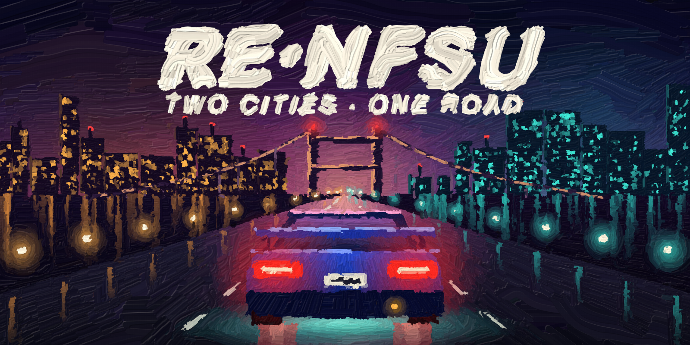
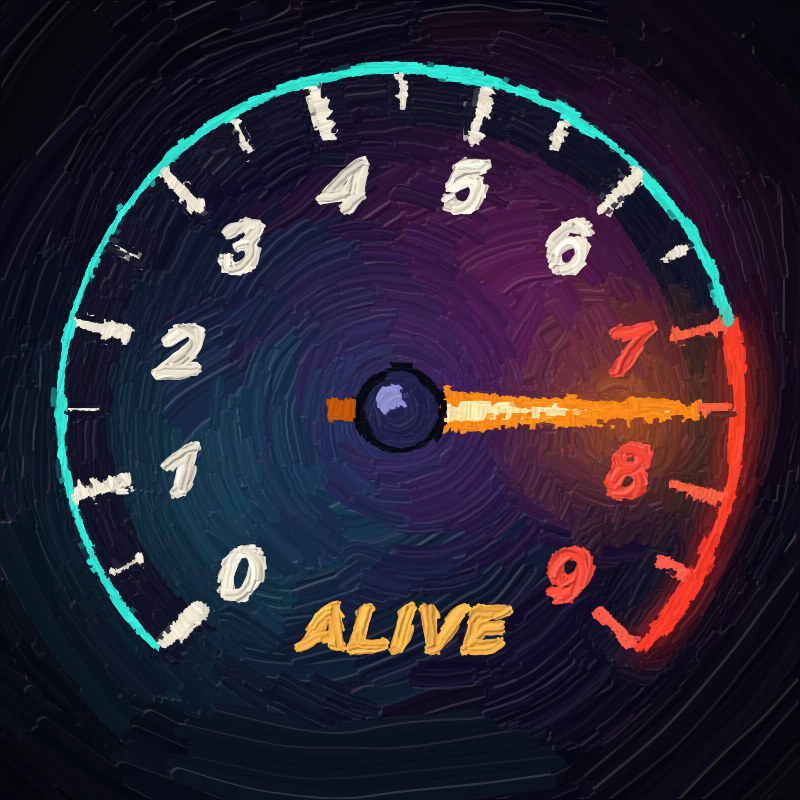
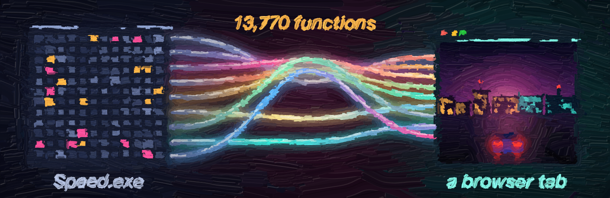
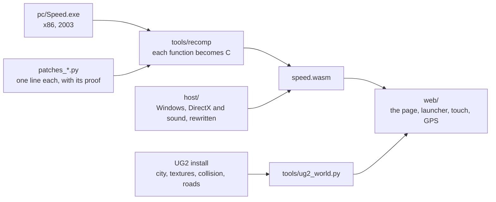
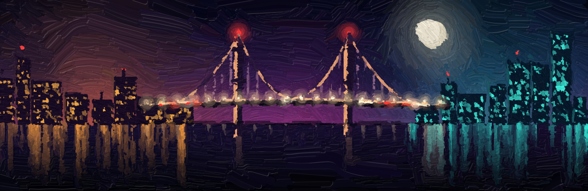

# Need for Speed: Underground, recompiled for the browser

**The 2003 PC game runs in a browser tab, with the city of Underground 2 joined to it by one road.**

`LIVE · nfsu.cc` · `x86 → WebAssembly` · `1,003 commits in 28 days` · `PRIVATE`

## In one minute

| Goal | Method | Result |
|---|---|---|
| Open a link, play NFSU1, drive into the UG2 city | `Speed.exe` translated function by function into WebAssembly | Live at [nfsu.cc](https://nfsu.cc), on PC and phones |

| Functions translated | Game program | Sent to the browser | Windows and DirectX stand-in |
|---:|---:|---:|---:|
| 13,770 | 70.5 MB of WebAssembly | 13.0 MB compressed | 14,650 lines of C |

No emulator runs the game. The original program is read once, on our side, and written again as code a browser understands. The game on the page is the game from 2003, with the same physics, rivals and menus.

 

## What it looks like

<table>
<tr>
<td width="50%"></td>
<td width="50%"></td>
</tr>
<tr>
<td align="center">Bayview, the UG2 city, driven with the NFSU1 car, HUD and route</td>
<td align="center">The launcher, drawn in the game's own menu style</td>
</tr>
<tr>
<td width="50%"></td>
<td width="50%"></td>
</tr>
<tr>
<td align="center">One map for both cities: mark a spot, follow the route or teleport</td>
<td align="center">The same build on a phone, with touch controls</td>
</tr>
</table>

## How it works

| Step | What happens | Where |
|---|---|---|
| Read | Every function of the game is found and named | `census/`, `docs/re/` |
| Translate | Each function is written again as C, then compiled | `tools/recomp/` |
| Stand in | The parts of Windows the game calls are rewritten for the browser | `host/` |
| Change | Every change to the game is a small patch that names its proof in the binary | `tools/recomp/patches_*.py` |
| Serve | Static files only, no server of our own | `tools/build_public.py`, `docs/re/hosting.md` |

## Two cities, one road

WORLD is a mode of its own. Olympic City (NFSU1) and Bayview (NFSU2) are one map, joined by a bridge, with no loading cut. The UG2 city brings its streets, textures, collision and road network. The sky, the fog and the look stay those of NFSU1.

| | Rows | Signed | Built, waiting on a play test | Open |
|---|---:|---:|---:|---:|
| Step 1: the UG2 city in NFSU1 | 13 | 5 | 8 | 0 |
| Step 2: public on the internet | 11 | 1 | 5 | 5 |

The live state, row by row with its evidence, is in [`web/plan/plan.json`](web/plan/plan.json).

## Where to look

| Rules and map | Last close | What done means | Findings in the binary | The open world | The UG2 bridge |
|---|---|---|---|---|---|
| [`AGENTS.md`](AGENTS.md) | [`HANDOFF.md`](HANDOFF.md) | [`docs/GOAL.md`](docs/GOAL.md) | [`docs/re/`](docs/re) | [`docs/OPENWORLD.md`](docs/OPENWORLD.md) | [`docs/re/ug2_bridge.md`](docs/re/ug2_bridge.md) |

| Folder | `tools/recomp` | `host` | `web` | `census` | `docs/re` | `tools/hopper` |
|---|---|---|---|---|---|---|
| Holds | The translator and the patches | Windows and DirectX, rewritten | The page the player opens | Names and tables read from the binary | Reverse engineering notes | Queries for the disassembler |

## What is not here

| Missing | `pc/Speed.exe`, `pc/ug2/SPEED2.EXE` | `game/`, the UG2 install | `build/`, `dist/`, `web/out/` |
|---|---|---|---|
| Why | The original programs stay out of git | Game data stays out of git | Built files, made again by `tools/recomp/build.py web` |

The repo does not run alone: it needs a bought copy of both games on the machine.

## The paintings

The four pictures on this page are painted by code. No image goes in: each scene draws a hidden picture with plain shapes, and a painter repaints it in thousands of brush strokes, from wide to fine, with the relief of thick paint. Open [`docs/art/paint.html`](docs/art/paint.html) in a browser to watch them being painted.

---

Fan project for personal research, made from bought copies of the games. Not affiliated with or endorsed by Electronic Arts. Need for Speed is a trademark of Electronic Arts Inc.
