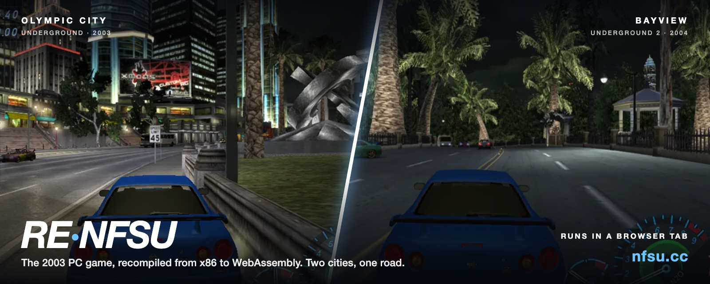
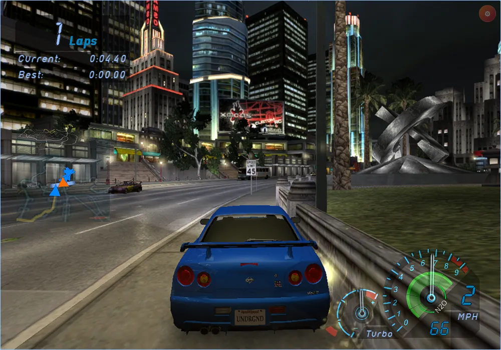
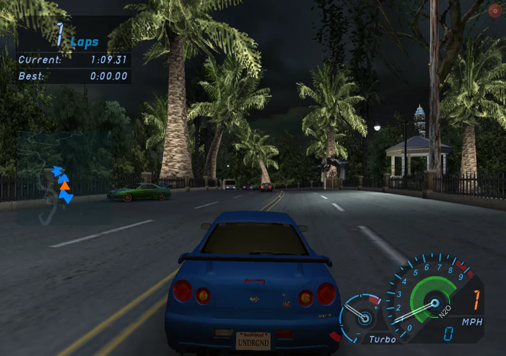
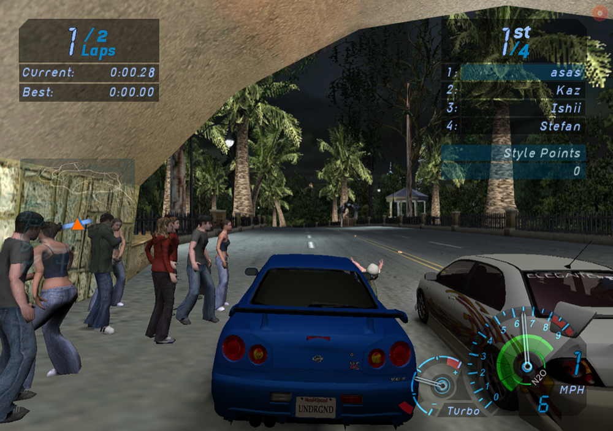
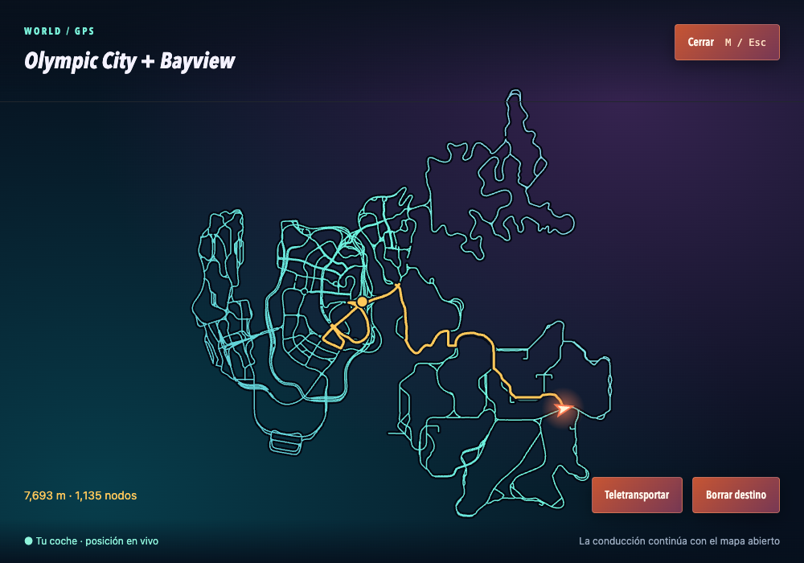
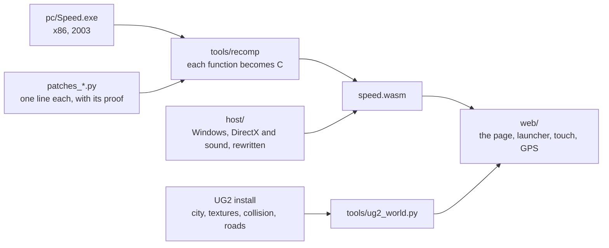
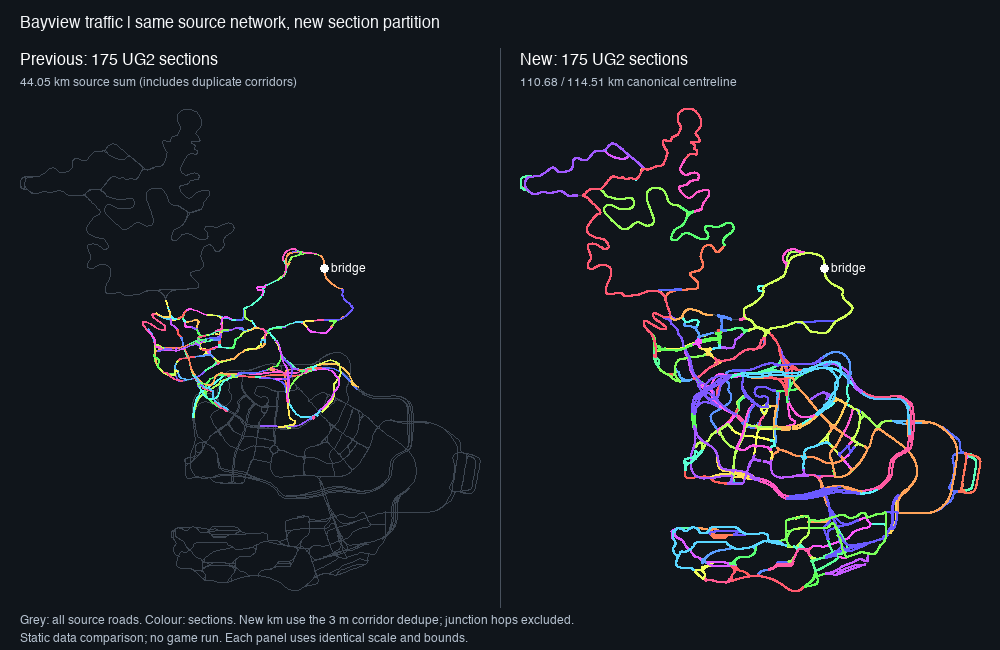

<div align="center">

<a href="https://nfsu.cc"></a>

# Need for Speed: Underground, recompiled for the browser

**The 2003 PC game runs in a browser tab, with the city of Underground 2 joined to it by one road.**

[](https://nfsu.cc)


[Play](https://nfsu.cc) · [What it looks like](#what-it-looks-like) · [How it works](#how-it-works) · [Two cities](#two-cities-one-road) · [Status](#status) · [Repo map](#repo-map)

</div>

> [!NOTE]
> No emulator runs the game. `Speed.exe` is read once, on our side, and every function is written again as code a browser understands. What plays on the page is the game from 2003: same physics, same rivals, same menus.

## In numbers

| Functions translated | Game program | Sent to the browser | Windows and DirectX stand-in | Game data served |
|---:|---:|---:|---:|---:|
| **13,770** | **70.5 MB** of WebAssembly | **13.0 MB** compressed | **14,650** lines of C | **1.95 GB**, songs and movies kept |

## What it looks like

<table>
<tr>
<td width="50%"></td>
<td width="50%"></td>
</tr>
<tr>
<td align="center"><b>Olympic City</b><br><sub>The NFSU1 city, as shipped in 2003</sub></td>
<td align="center"><b>Bayview</b><br><sub>The NFSU2 city, driven with the NFSU1 car, HUD and physics</sub></td>
</tr>
<tr>
<td></td>
<td></td>
</tr>
<tr>
<td align="center"><b>Races anywhere</b><br><sub>A race start laid on Bayview streets, crowd and rivals included</sub></td>
<td align="center"><b>One map</b><br><sub>Both cities: mark a spot, follow the route or teleport</sub></td>
</tr>
<tr>
<td></td>
<td></td>
</tr>
<tr>
<td align="center"><b>Launcher</b><br><sub>Quality, game mode, volume and controls, in the game's menu style</sub></td>
<td align="center"><b>Everything unlocked</b><br><sub>Every car and part open from the first minute</sub></td>
</tr>
<tr>
<td colspan="2"></td>
</tr>
<tr>
<td colspan="2" align="center"><b>Phones</b><br><sub>The same build on a phone screen, with touch controls</sub></td>
</tr>
</table>

## How it works



| Step | Read | Translate | Stand in | Change | Serve |
|---|---|---|---|---|---|
| What happens | Every function of the game is found and named | Each function is written again as C, then compiled | The parts of Windows the game calls are rewritten for the browser | Every change to the game is a small patch that names its proof in the binary | Static files only, no server of our own |
| Where | `census/`, `docs/re/` | `tools/recomp/` | `host/` | `tools/recomp/patches_*.py` | `tools/build_public.py` |

> [!IMPORTANT]
> One rule holds the project together: every value, format or patch names what proves it in the binary or the data (an address, a chunk id, a file and line). What is not proven is marked UNKNOWN, and nothing is built on it.

## Two cities, one road

WORLD is a mode of its own. Olympic City (NFSU1) and Bayview (NFSU2) are one map, joined by a bridge, with no loading cut. The UG2 city brings its streets, textures, collision and road network. The sky, the fog and the look stay those of NFSU1.



<sub>The Bayview road network, read from the UG2 data and split into 175 traffic sections. Left: the first split covered 44 km. Right: the current one covers 110.68 of 114.51 km. The white dot is the bridge to Olympic City.</sub>

## Status

| | Rows | Signed | Built, waiting on a play test | Open |
|---|---:|---:|---:|---:|
| Step 1: the UG2 city in NFSU1 | 13 | 5 | 8 | 0 |
| Step 2: public on the internet | 11 | 1 | 5 | 5 |

The live state, row by row with its evidence, is in [`web/plan/plan.json`](web/plan/plan.json). The last close is in [`HANDOFF.md`](HANDOFF.md).

## Repo map

| Folder | `tools/recomp` | `host` | `web` | `census` | `docs/re` | `tools/hopper` |
|---|---|---|---|---|---|---|
| Holds | The translator and the patches | Windows and DirectX, rewritten | The page the player opens | Names and tables read from the binary | Reverse engineering notes | Queries for the disassembler |

| Read first | Rules and map | What done means | The open world | The UG2 bridge | Hosting |
|---|---|---|---|---|---|
| File | [`AGENTS.md`](AGENTS.md) | [`docs/GOAL.md`](docs/GOAL.md) | [`docs/OPENWORLD.md`](docs/OPENWORLD.md) | [`docs/re/ug2_bridge.md`](docs/re/ug2_bridge.md) | [`docs/re/hosting.md`](docs/re/hosting.md) |

<details>
<summary><b>Build and run</b></summary>

```sh
.venv/bin/python tools/recomp/build.py web   # translate and compile
tools/serve.py                               # serve on :5180
node tools/webcheck.mjs --route              # boot check in headless Chrome
```

The repo does not run alone. It needs a bought copy of both games on the machine.

| Not in git | `pc/Speed.exe`, `pc/ug2/SPEED2.EXE` | `game/`, the UG2 install | `build/`, `dist/`, `web/out/` |
|---|---|---|---|
| Why | The original programs stay out | Game data stays out | Built files, made again by the build |

</details>

---

<sub>Fan project for personal research, made from bought copies of the games. Not affiliated with or endorsed by Electronic Arts. Need for Speed is a trademark of Electronic Arts Inc.</sub>
