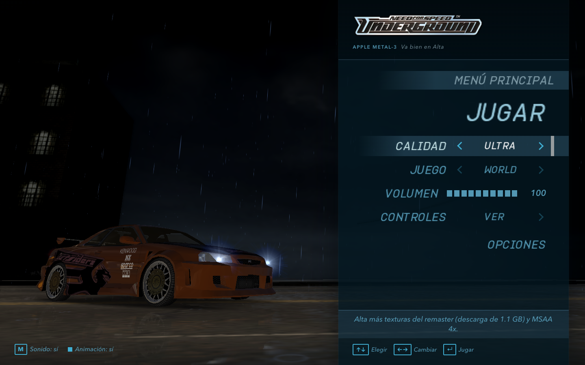
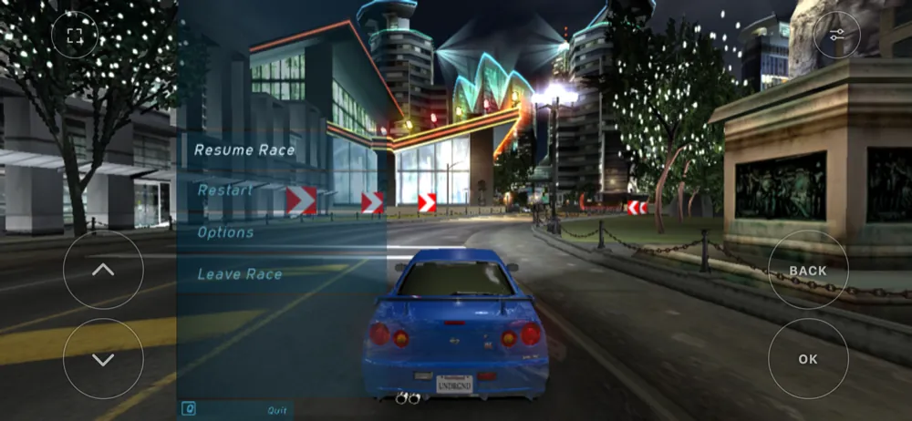
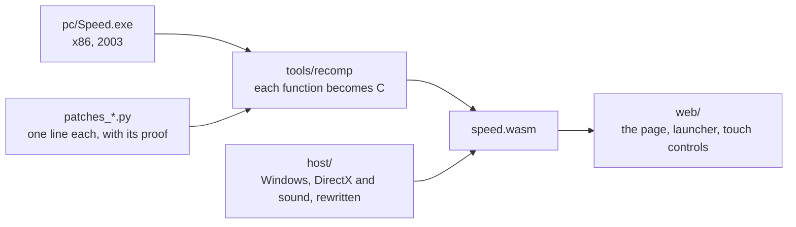

<div align="center">

<a href="https://nfsu.cc"></a>

# Play Need for Speed Underground online, in your browser

**The 2003 PC game, free in a browser tab: no download, no install, no emulator. Open [nfsu.cc](https://nfsu.cc) and race on PC or phone. Under the hood, every function of `Speed.exe` was recompiled from x86 to WebAssembly.**

<a href="https://nfsu.cc"></a>


**English** · [Español](README.es.md)

[Play](https://nfsu.cc) · [What it looks like](#what-it-looks-like) · [How it works](#how-it-works) · [Guides](#guides-and-devlog) · [Repo map](#repo-map)

</div>

> [!NOTE]
> No emulator runs the game. `Speed.exe` is read once, on our side, and every function is written again as code a browser understands. What plays on the page is the game from 2003: same physics, same rivals, same menus, same soundtrack.

## Play

1. Open **[nfsu.cc](https://nfsu.cc)** in Chrome, Edge, Firefox or Safari, on a computer or a phone. Any recent browser with WebGPU works ([details](https://nfsu.cc/blog/en/browsers-phones-performance-settings.html)).
2. Press **Play**. The first visit downloads the game data once; later visits start from the browser cache.
3. Drive with the keyboard, a gamepad or the touch controls. Your profile and saves stay in your own browser.

## In numbers

| Functions translated | Game program | Sent to the browser | Windows and DirectX stand-in | Game data served |
|---:|---:|---:|---:|---:|
| **13,770** | **70.5 MB** of WebAssembly | **13.0 MB** compressed | **14,650** lines of C | **1.95 GB**, songs and movies kept |

## What it looks like

<table>
<tr>
<td width="50%"></td>
<td width="50%"></td>
</tr>
<tr>
<td align="center"><b>Olympic City</b><br><sub>The city as shipped in 2003, running in Chrome</sub></td>
<td align="center"><b>Launcher</b><br><sub>Quality, game mode, volume and controls, in the game's menu style</sub></td>
</tr>
<tr>
<td></td>
<td></td>
</tr>
<tr>
<td align="center"><b>Car select</b><br><sub>The original menus, unchanged</sub></td>
<td align="center"><b>Phones</b><br><sub>The same build on a phone screen, with touch controls</sub></td>
</tr>
</table>

## How it works



| Step | Read | Translate | Stand in | Change | Serve |
|---|---|---|---|---|---|
| What happens | Every function of the game is found and named | Each function is written again as C, then compiled | The parts of Windows the game calls are rewritten for the browser | Every change to the game is a small patch that names its proof in the binary | Static files only, no server of our own |
| Where | [`census/`](census), [`docs/re/`](docs/re) | [`tools/recomp/`](tools/recomp) | [`host/`](host) | [`tools/recomp/patches_*.py`](tools/recomp) | [`tools/build_public.py`](tools/build_public.py) |
| Read how | [RE tools](https://nfsu.cc/blog/en/reverse-engineering-tools-ghidra-hopper-rea.html) | [Static recompilation](https://nfsu.cc/blog/en/static-recompilation-x86-to-webassembly.html) | [DirectX 9 on WebGPU](https://nfsu.cc/blog/en/directx-9-and-windows-on-webgpu.html) | [The lifter's patches](https://nfsu.cc/blog/en/static-recompilation-x86-to-webassembly.html) | [Hosting 2 GB](https://nfsu.cc/blog/en/hosting-a-2-gb-game-on-cloudflare-r2-load-time.html) |

> [!IMPORTANT]
> One rule holds the project together: every value, format or patch names what proves it in the binary or the data (an address, a chunk id, a file and line). What is not proven is marked UNKNOWN, and nothing is built on it.

## Guides and devlog

| Play | [Play online](https://nfsu.cc/blog/en/play-need-for-speed-underground-online.html) | [Controls](https://nfsu.cc/blog/en/need-for-speed-underground-controls-keyboard-gamepad-phone.html) | [Browsers, phones, settings](https://nfsu.cc/blog/en/browsers-phones-performance-settings.html) |
|---|---|---|---|
| **How it was made** | [Static recompilation, x86 to WebAssembly](https://nfsu.cc/blog/en/static-recompilation-x86-to-webassembly.html) | [DirectX 9 and Windows on WebGPU](https://nfsu.cc/blog/en/directx-9-and-windows-on-webgpu.html) | [Reverse engineering tools](https://nfsu.cc/blog/en/reverse-engineering-tools-ghidra-hopper-rea.html) |
| **More** | [Hosting a 2 GB game](https://nfsu.cc/blog/en/hosting-a-2-gb-game-on-cloudflare-r2-load-time.html) | [Reverse engineering with AI agents](https://nfsu.cc/blog/en/reverse-engineering-a-game-with-ai-agents.html) | [All posts](https://nfsu.cc/blog/en/index.html) |

## Status

The game is live at [nfsu.cc](https://nfsu.cc). Step 2 of the plan, public on the internet, has 11 rows: 1 verified, 5 built and waiting on a play test, 5 open. The live state, row by row with its evidence, is in [`web/plan/plan.json`](web/plan/plan.json). The last close is in [`HANDOFF.md`](HANDOFF.md).

## Repo map

| Folder | [`tools/recomp`](tools/recomp) | [`host`](host) | [`web`](web) | [`census`](census) | [`docs/re`](docs/re) | [`tools/hopper`](tools/hopper) |
|---|---|---|---|---|---|---|
| Holds | The translator and the patches | Windows and DirectX, rewritten | The page the player opens | Names and tables read from the binary | Reverse engineering notes | Queries for the disassembler |
| Guide | [Recompilation](https://nfsu.cc/blog/en/static-recompilation-x86-to-webassembly.html) | [Windows on WebGPU](https://nfsu.cc/blog/en/directx-9-and-windows-on-webgpu.html) | [Play](https://nfsu.cc/blog/en/play-need-for-speed-underground-online.html) | [RE tools](https://nfsu.cc/blog/en/reverse-engineering-tools-ghidra-hopper-rea.html) | [RE tools](https://nfsu.cc/blog/en/reverse-engineering-tools-ghidra-hopper-rea.html) | [RE tools](https://nfsu.cc/blog/en/reverse-engineering-tools-ghidra-hopper-rea.html) |

| Read first | Rules and map | What done means | Hosting |
|---|---|---|---|
| File | [`AGENTS.md`](AGENTS.md) | [`docs/GOAL.md`](docs/GOAL.md) | [`docs/re/hosting.md`](docs/re/hosting.md) |

<details>
<summary><b>Build and run</b></summary>

```sh
.venv/bin/python tools/recomp/build.py web   # translate and compile
tools/serve.py                               # serve on :5180
node tools/webcheck.mjs --route              # boot check in headless Chrome
```

The repo does not run alone. It needs a bought copy of the game on the machine.

| Not in git | `pc/Speed.exe` | `game/` | `build/`, `dist/`, `web/out/` |
|---|---|---|---|
| Why | The original program stays out | Game data stays out | Built files, made again by the build |

</details>

---

<sub>Fan project for personal research, made from a bought copy of the game. `Speed.exe` and the game's install files are not stored in this repository. Not affiliated with or endorsed by Electronic Arts. Need for Speed is a trademark of Electronic Arts Inc.</sub>
